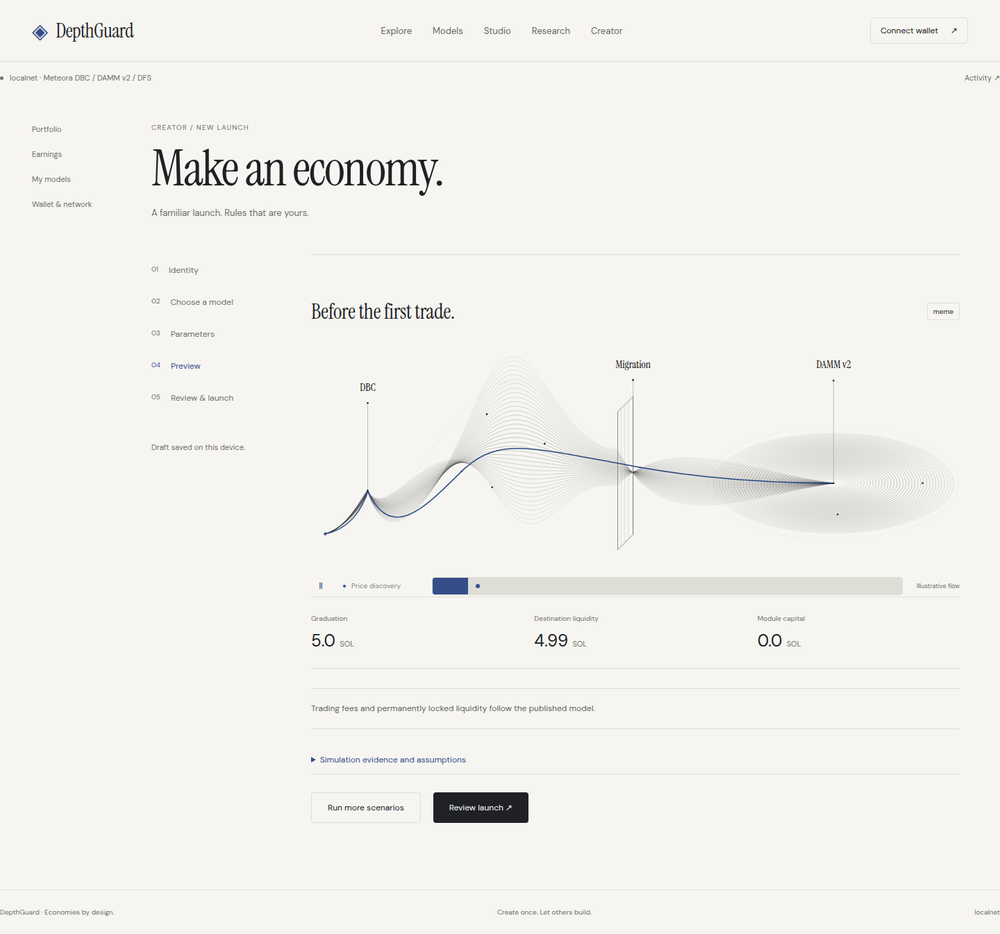
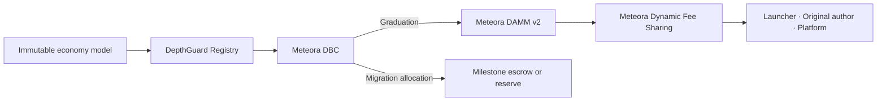

# DepthGuard

**Design the economy. Launch the token.**

[](https://github.com/pandu926/DepthGuard/actions/workflows/frontend.yml) [](https://github.com/pandu926/DepthGuard/actions/workflows/backend.yml)

DepthGuard is a Solana platform for creating, testing, launching, and reusing token economy models. Meteora Dynamic Bonding Curves power price discovery; DAMM v2 provides the market after graduation; Dynamic Fee Sharing distributes trading fees to the launcher, model author, and platform.

[Live Devnet app](https://depthguard.rbexp.com) · [Product handbook](https://depthguard.rbexp.com/docs) · [Presentation](https://depthguard.rbexp.com/pitch.html) · [Getting started](docs/GETTING_STARTED.md) · [Verification](docs/VERIFICATION.md)



## The product

A launchpad usually gives creators one economic template. DepthGuard makes the template itself a reusable product: choose a model, configure its supported terms, simulate its behavior, then launch with an immutable commitment to the executable parameters.

| Workspace | What users can do |
| --- | --- |
| Explore | Discover tokens, inspect their models, and trade through DBC or DAMM v2. |
| Creator | Configure token identity and launch terms; preview and follow the signing workflow. |
| Economy Studio | Edit models, import/export configurations, publish immutable versions, and preserve author attribution on official forks. |
| Research | Compare supported analytical scenarios, run sensitivity grids, and export results. |
| Portfolio & Earnings | Manage balances and WSOL, exercise holder rights, and claim allocated fees. |
| Getting started | Choose a purpose, understand the network, and follow a guided first action. |

## One platform, multiple mechanisms

| Mechanism | Behavior | Status |
| --- | --- | --- |
| Community launch | DBC price discovery followed by permanently locked, DFS-owned DAMM v2 liquidity. | Verified on Devnet |
| Milestone funding | A migration allocation funds escrow; reviewer majorities release milestone budgets or enable holder burn refunds. | Verified on Devnet |
| Reserve redemption | A migration allocation funds a reserve; holders burn tokens for a proportional share of the remaining quote balance. | Verified on Devnet |
| Asset-quote markets | Research configurations for launching against alternative quote assets. | Research only; external issuer adapters and real tokenized-stock launches are not accepted |

Supported launches currently use standard SPL base tokens and WSOL quote. The advanced native editor exposes a broader research inventory; structural validation does not certify that every configuration is launchable.

## Meteora is the execution layer



The Registry validates launch terms and native account relationships. Migration verification checks the destination pool and permanently locked DFS-owned position. Trading fees and project/reserve capital remain separate. Official model forks retain the original author and royalty policy.

Read [architecture](docs/ARCHITECTURE.md), [economy models and mathematics](docs/ECONOMY_MODELS.md), and the [Anchor program reference](contracts/README.md).

## Verification

The recorded frontend acceptance run covers **25 feature groups, five launches, and 97 finalized Devnet application transactions**, including DBC trading, DAMM v2 migration, milestone approvals/rejection/expiry, reserve redemption, fee claims, model reuse, and mobile routes.

- [Frontend acceptance report](web/tests/evidence/frontend-devnet-report.md)
- [Raw frontend evidence](web/tests/evidence/frontend-devnet.json)
- [Verified Devnet deployment](contracts/tests/evidence/devnet-deployment.json)
- [Contract adversarial acceptance](contracts/tests/evidence/security-summary.json)
- [Security scope and trust boundaries](SECURITY.md)

The browser harness uses real Ed25519 wallets through an automated Wallet Standard adapter. It does not certify Phantom or Solflare extension approval flows. Analytical simulations are not forecasts or proof of universal economic outperformance.

**Release status: Devnet.** Mainnet broadcasting is blocked. Independent audit, extension-wallet acceptance, and production operational acceptance remain release requirements.

## Development

Requirements: Node.js 22, Rust 1.97.1, PostgreSQL 17, and Docker Compose. Anchor builds additionally use Anchor CLI 1.0.2 and the pinned Agave toolchain.

```bash
git clone https://github.com/pandu926/DepthGuard.git
cd DepthGuard
npm ci
npm run repo:check
npm run check
npm run web:test
npm run build
```

To run the connected application, follow [local setup](docs/GETTING_STARTED.md). For isolated program-backed tests, see [verification commands](docs/VERIFICATION.md).

## Repository

```text
backend/                 Rust API, worker, native helpers, migrations, operations
contracts/               Anchor Registry, Escrow, Reserve, IDLs, adversarial tests
web/                     React/Vite app, product handbook, browser acceptance
packages/engine/         Independent decimal mathematics and SBF test runtime
proof/                   Reproducible migration-continuity regression
server/                  Isolated test API used by SBF integration tests
scripts/                 Local test runners
tests/                   Independent SBF integration suite
docs/                    Architecture, setup, models, verification, release reference
.github/                 CI and contribution templates
```

The customer application uses the Rust backend. The TypeScript test API is an independent local verification harness.

See [contribution guidelines](CONTRIBUTING.md) before proposing a change. Existing package and third-party license notices are retained; no project-wide open-source license has been added.
