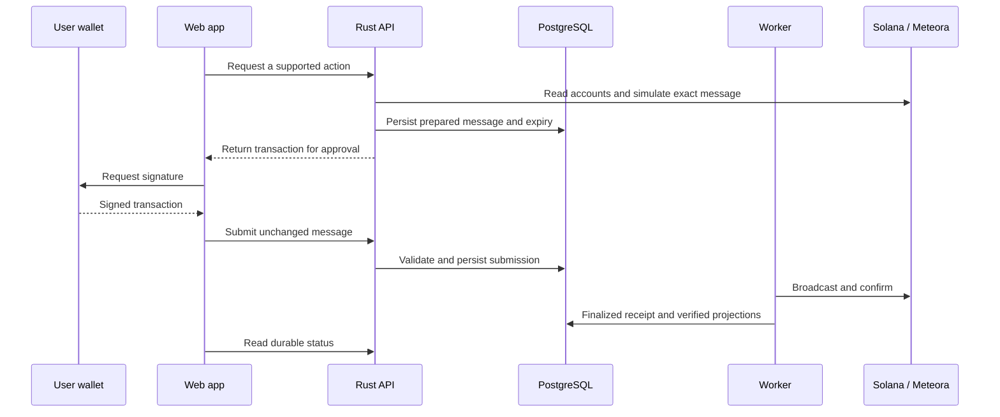

# Architecture

## Components

| Component | Responsibility |
| --- | --- |
| React / Vite / TypeScript | Consumer workflows, wallet signatures, previews, model editing, research, and documentation |
| Axum API | Authentication, authorization, canonical validation, transaction preparation, and public catalog |
| PostgreSQL / SQLx | Immutable model versions, launch workflows, prepared messages, jobs, receipts, and projections |
| Rust worker | Leased research jobs, broadcasts, finality recovery, indexing, and outbox processing |
| Native Rust helper | Official pinned DBC, DAMM v2, and DFS quotes and instruction building |
| SBF Rust helper | Isolated LiteSVM execution with checksum-verified native program fixtures |
| Anchor Registry | Model commitments, inherited royalties, factory execution, migration verification, capital activation |
| Anchor Escrow | Milestone votes, budget releases, expiry, and token-burn refunds |
| Anchor Reserve | Donations and atomic proportional burn redemption |

## Transaction boundaries

The server binds prepared messages to the owner, action, state, expiry, and required signatures. A signed transaction must match the stored message. Preparation and simulation are separate from finalized execution; the UI follows durable receipts rather than treating a wallet approval as success.

Factory steps are ordered and recoverable. Repeated requests use idempotency and persisted workflow state. Finality workers reconcile ambiguous broadcasts; projections use finalized observations.

## Model identity and reuse

Drafts have revision checks. Publication creates an immutable canonical model version. The Registry seals an executable Borsh commitment; it verifies executable terms independently of the displayed JSON. Official forks inherit the original author and fee policy. An unrelated independent program deployment is outside that royalty guarantee.

## Fee and capital accounting

DFS distributes trading fees using the immutable recipient policy. Migration allocations fund the configured Escrow or Reserve through verified native withdrawal and activation. Project capital, reserve capital, and trading-fee earnings are separate balances and events.

## Isolation

Application, native Solana, and SBF helper workspaces remain separate to avoid incompatible upstream address/account types. Helpers accept bounded JSON through fixed operator-configured executables. Runtime database permissions exclude schema administration; migrations use a dedicated privileged connection.

All native dependency revisions and lockfiles are pinned. Downloaded program fixtures are hash-checked. Local SBF parity, public Devnet execution, and production certification are distinct verification scopes.
